<p align="center">
  <picture>
    <source media="(prefers-color-scheme: dark)" srcset="assets/logo-mark-dark.svg">
    
  </picture>
</p>

<h1 align="center">yogan</h1>

<p align="center">Parallel Claude Code workers, one PR each</p>

---

yogan is a terminal UI that runs several Claude Code sessions in parallel on one repo. You describe
the work, approve the plan, and review each finished diff. Nothing is pushed until you approve the
pull request.

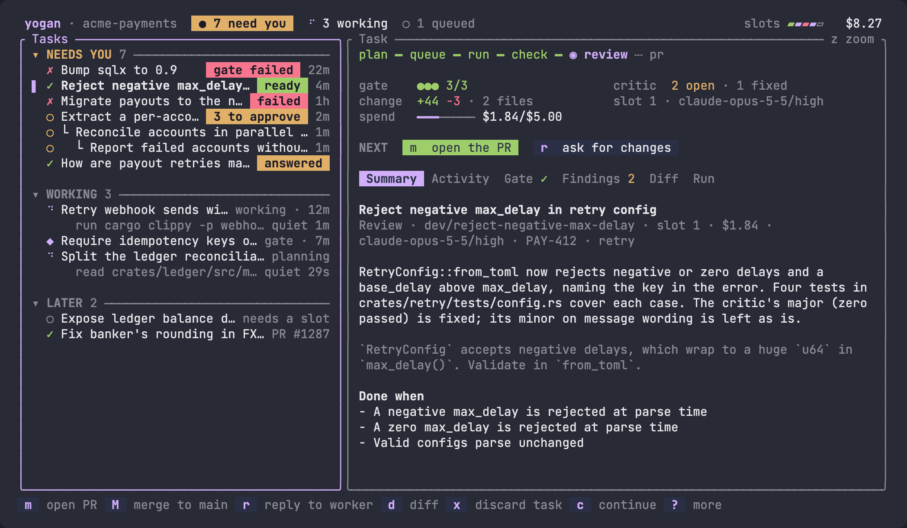

## How it works

```
request → lead → proposals → you approve → worker → gate → critic → you review → PR
                                             ▲                │
                                             └── fix rounds ──┘
```

- **A lead plans, you approve.** A read-only session splits your request into tasks, each with
  testable acceptance criteria.
- **Workers run in isolation.** Each task gets its own persistent git worktree, so builds stay warm.
- **Checked before you see it.** yogan runs your gate (fmt, clippy, tests) itself, then a critic
  session on a different model tries to break the change. Failures go back to the worker.
- **One task, one PR.** yogan drafts the PR; you approve it, and it pushes and opens it with `gh`.
- **Runs unattended.** Agents are detached processes, so closing the terminal stops nothing.
  Stalls get nudged, spend is capped, and every failure ends in a visible status.

## Install

You need macOS or Linux, [Claude Code](https://docs.claude.com/en/docs/claude-code) signed in,
`git`, an authenticated [GitHub CLI](https://cli.github.com) (`gh`) and Rust 1.88 or later.

```sh
git clone https://github.com/yoganlava/yogan-swarm.git
cd yogan-swarm
make install    # installs `yogan` into ~/.cargo/bin
```

Then run `yogan` from inside any repo.

## Walkthrough

The screenshots are the real TUI on a sample repo.

**1. Ask for work.** Press `n`, type a request and submit. Auto lets the lead decide whether to plan
or answer, Plan always files tasks and Ask always answers. An optional ticket ID goes into every PR
title.

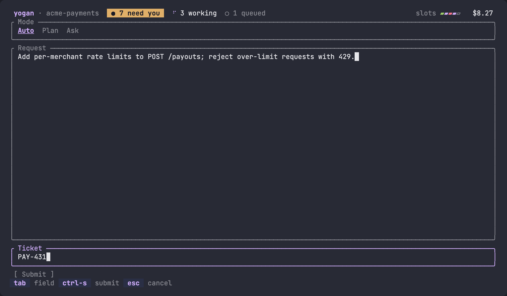

**2. Approve the plan.** Proposals appear under **Needs you** with their acceptance criteria. Press
`a` to approve one, `A` for all, `e` to edit, or `r` to send the lead feedback.

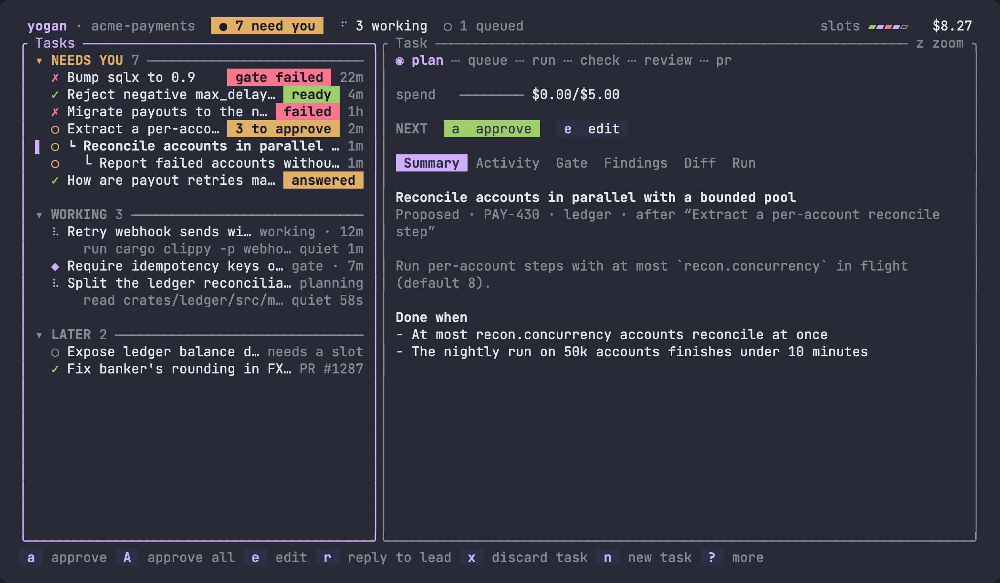

**3. Watch, or walk away.** Approved tasks start as slots free up. Activity shows each tool call as
it happens.

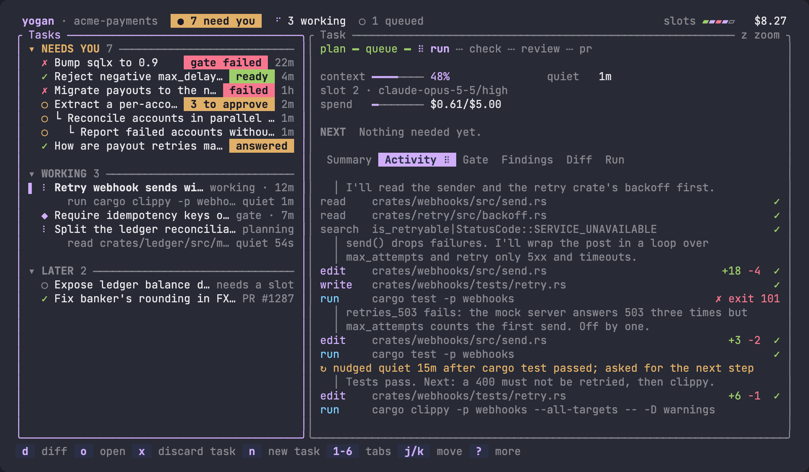

**4. Review.** When a task reaches Review, its tabs show the gate, the critic's findings and the
diff. Press `r` to ask for changes or `c` to take over the session yourself.

| Gate | Findings | Diff |
| --- | --- | --- |
| 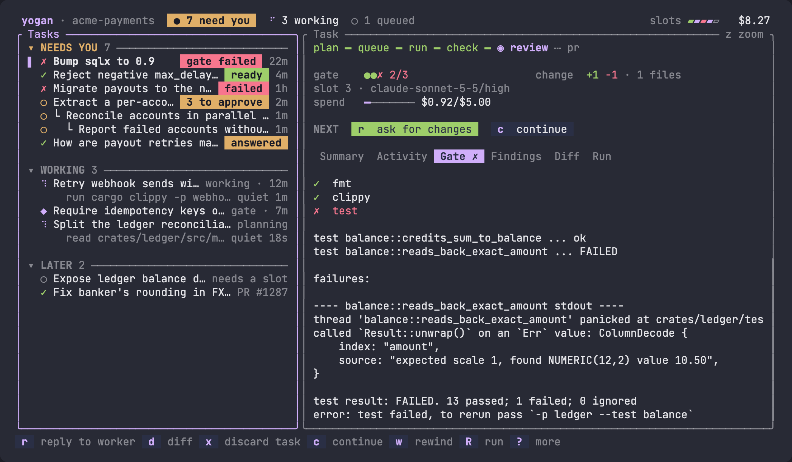 | 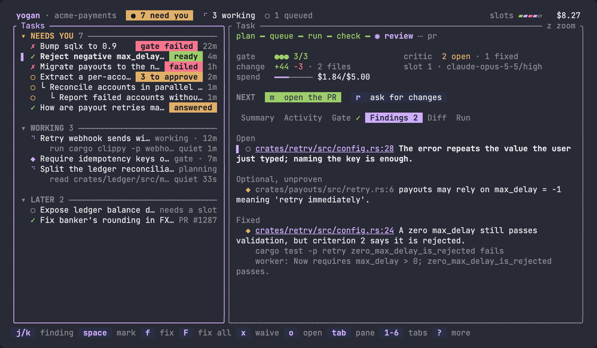 | 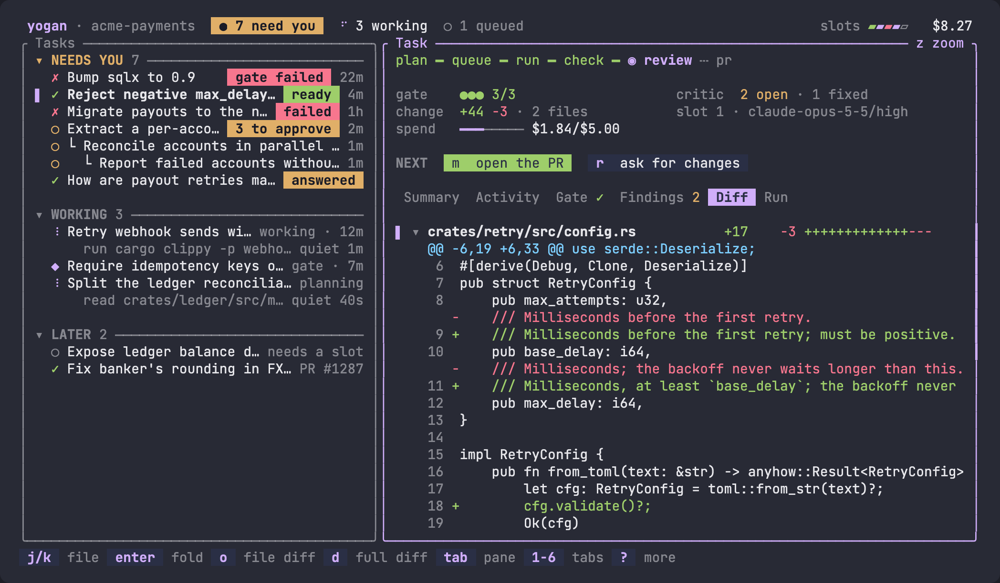 |

**5. Ship.** Press `m` to draft the PR. `g` regenerates it with an instruction, `e` edits, and
`enter` pushes the branch and opens the PR.

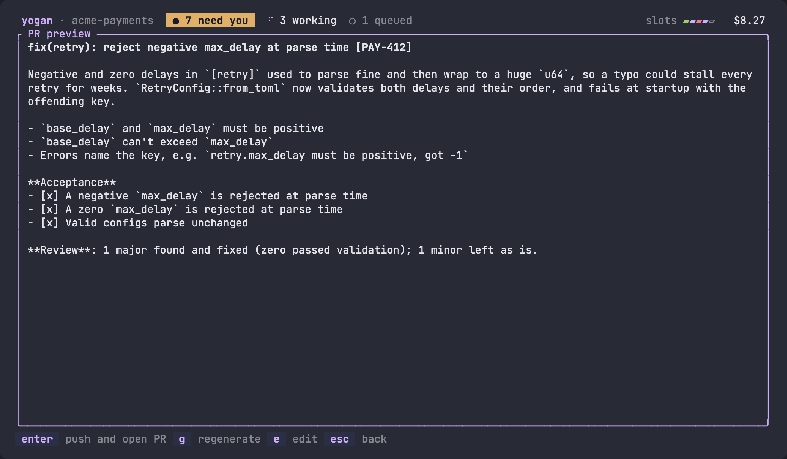

Questions skip all of this: the lead answers in Markdown, citing files. Press `p` to turn an
answer into a plan.

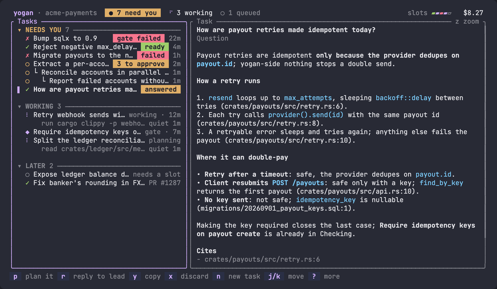

## Keys

Press `?` for the command palette, which lists every key valid for the selection.

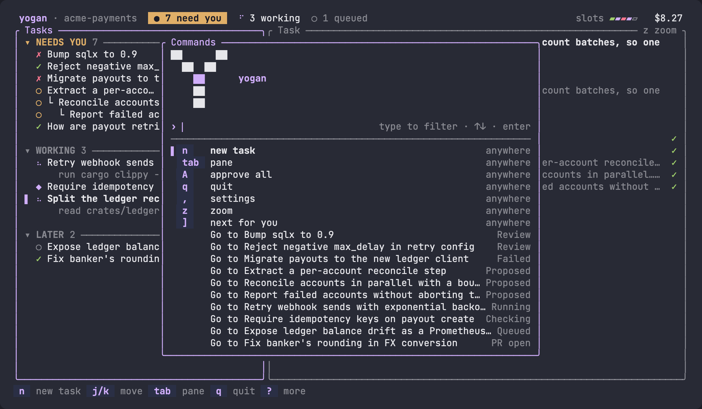

<details>
<summary>All keys</summary>

| Key | Action |
| --- | --- |
| `n` | New request |
| `j` `k` / `↑` `↓` | Move selection |
| `tab`, `1`–`6` | Switch pane, switch tab |
| `a` / `A` | Approve a proposal / all proposals; in Review, allow the worker's denied calls |
| `e` | Edit a proposal or the PR draft |
| `r` | Reply to the lead or worker, or ask a follow-up |
| `p` | Turn an answer into a plan |
| `m` / `M` | Draft the PR / rebase and push to main |
| `g` | Regenerate the PR draft |
| `d` | Full diff in `$PAGER` |
| `w` | Rewind to one of the worker's commits |
| `t` | Retry a failed task on another model |
| `c` | Continue the session interactively |
| `R` | Start or stop the slot's run script |
| `o` | Open the selected file or worktree |
| `x` | Discard the task |
| `y` | Copy the answer |
| `z` | Zoom the detail pane |
| `]` | Next task that needs you |
| `,` | Settings |
| `q` | Quit (agents keep running) |

The mouse works too: click selects, double-click zooms and hovering shows a target's key.

</details>

## Configuration

yogan writes nothing into your repo. Settings (`,`) edits the config for you; the files are
plain TOML if you prefer editing by hand.

```toml
# ~/.config/yogan/config.toml
branch_prefix = "you/"

[projects]
"my-repo" = "~/.config/yogan/projects/my-repo.toml"   # keyed by the origin repo name
```

A project file overrides any table of the [defaults](src/defaults.toml):

```toml
# ~/.config/yogan/projects/my-repo.toml
[worker]
concurrency = 3
budget_usd = 8.0               # per-task spend ceiling; 0 turns it off

[gate]
steps = [
  { name = "clippy", run = "cargo clippy {crates} --all-targets -- -D warnings" },
  { name = "test",   run = "cargo test {crates}" },
]

[scripts]                      # optional, run in each slot
setup = "./scripts/worktree_up.sh"
run = "./scripts/dev.sh"
```

Gate steps take `{crates}` (the touched crates as `-p` flags) or `{paths}` (changed top-level
directories), so non-Rust repos work too.

<details>
<summary>More options</summary>

- **Precedence**, highest first: the task's own model and effort, the compose screen's, the
  project file, the global file, the built-in defaults.
- **Roles**: `[lead]`, `[ask]`, `[critic]`, `[worker]` and `[pr]` each set a `model` and
  `effort`.
- **Worker tools**: `[worker] mcp_config`, `read_tools`, `allowed_tools` and `deny` (added to the
  built-in deny list). `permission_mode = "auto"` (also in Settings) lets Claude Code's
  classifier approve other calls; anything still denied is listed in Review, where `a` allows it
  for that task and resumes the worker.
- **PR titles**: `[pr] title_format` and `types`.
- **Thresholds**: stalls, loops and handoffs in `[watch]`; slot cleanup in `[disk]`.
- **Ports**: `[ports] base` and `per_slot` give each slot its own range.
- **Environment**: `YOGAN_ASCII=1` for ASCII glyphs, `YOGAN_DIR` to move the state directory.
  Slot scripts get `YOGAN_ROOT`, `YOGAN_SLOT`, `YOGAN_SLOT_DIR`, `YOGAN_TASK_ID`, `YOGAN_CRATES`
  and, with `[ports]`, `YOGAN_PORT_BASE` and `YOGAN_PORT_COUNT`.
- **State** lives in `~/.local/share/yogan/<repo>/`: tasks, requests, redacted logs, findings,
  answers and the slot worktrees.

</details>

## VS Code

yogan is built for VS Code's integrated terminal. There it opens files with `code -g`, diffs with
`code --diff`, and follows your theme's colours. Below 24 rows it switches to a compact layout.

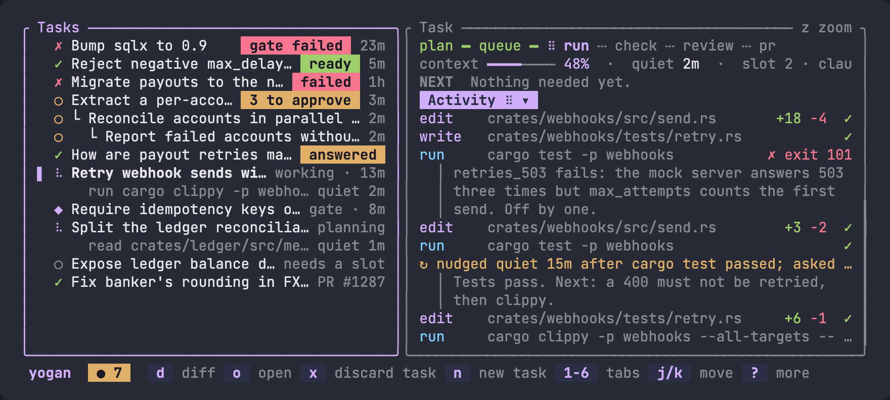

## Safety

Workers get an explicit tool allowlist, no user hooks or plugins, and a deny list covering
`git push`, `git reset`, `gh` and similar. That is a rule, not a sandbox: code an allowed tool runs,
such as `build.rs` or tests, runs as you. Use yogan on repos you trust.

## Development

```sh
cargo fmt && cargo clippy --all-targets -- -D warnings && cargo test
```

Screens are snapshot-tested with ratatui's `TestBackend`. Work is tracked as one ticket per file in
[`tickets/`](tickets).
